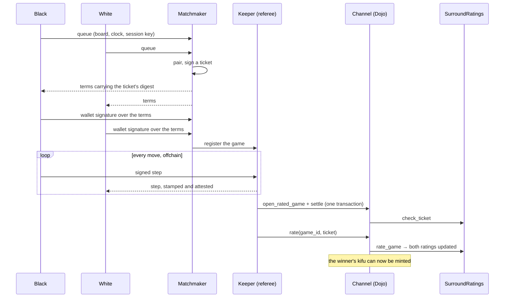

# Surround

Surround is Go played offchain and settled on Starknet. Moves are signed
messages between the two players, not transactions. A game touches the chain
only when it needs to: to settle its result, to resolve a dispute, or to force
a stalled opponent to move. Cairo checks every move it is shown, a Stwo proof can
stand in for replaying them, and ranked results update both players' ratings
in an onchain contract.

These pages explain the parts a player or integrator needs to trust:

- **[Gameplay](/gameplay/playing):** the rules of Go as Surround plays them,
  how a game is scored and every way it can end.
- **[Settlement](/settlement/offchain-play):** how a game played offchain
  becomes a result on Starknet, and what happens when a player stops
  cooperating.
- **[Ranking](/ranking/rated-games):** how a settled ranked game updates both
  ratings, the model behind it and the evidence for it.
- **[AI anchors](/ai-anchors):** the five fixed-strength KataGo opponents
  that hold the rank scale in place.
- **[Fair play](/fair-play):** how games are analyzed for AI assistance, and
  how accounts that show it are labeled.
- **[Kifu](/kifu):** the ERC-721 that records a settled ranked game, minted
  to its winner, with its record and artwork onchain.

## The life of a ranked game

1. **Pairing.** The matchmaker pairs two players on the same board and clock
   and signs a **ticket** that names them, the board, komi, clock, referee and
   prover.
2. **Agreement.** Each player names a fresh session key, and both wallets sign
   the game's **terms**, which carry the ticket's digest. Nothing is sent to
   the chain.
3. **Play.** Every move is signed with the player's session key and sent
   through a **keeper**, which stamps the clock and relays the move. Both
   clients check every signature before applying a move.
4. **Settlement.** When the game ends, the first transaction that needs the
   chain opens the game and settles it together, by a proof or by onchain
   replay of the signed moves.
5. **Rating.** Anyone may then call `rate`, and `SurroundRatings` updates both
   players from the result.
6. **Kifu.** Anyone may mint the game's kifu, which goes to the winner.

A casual game follows the same path without a ticket or a clock: it never
needs to reach the chain at all unless a player wants its result recorded.

## What it builds on

The channel, dispute state machine, proof adapter and SDK protocol come from
[arbiter](https://github.com/broody/arbiter), a library for offchain
turn-based games with onchain settlement. Surround supplies Go: its rules as
arbiter's `GameRules`, a thin Dojo system, a thin proof adapter, and the Go
codec for arbiter's JS SDK. Ratings are arbiter's game-agnostic ratings layer
with Go's constants.

:::warning
The contracts have not had an independent audit. Native proof verification
and Dojo world ownership carry their own trust assumptions, described under
[Settling a game](/settlement/settling#trust-assumptions).
:::
