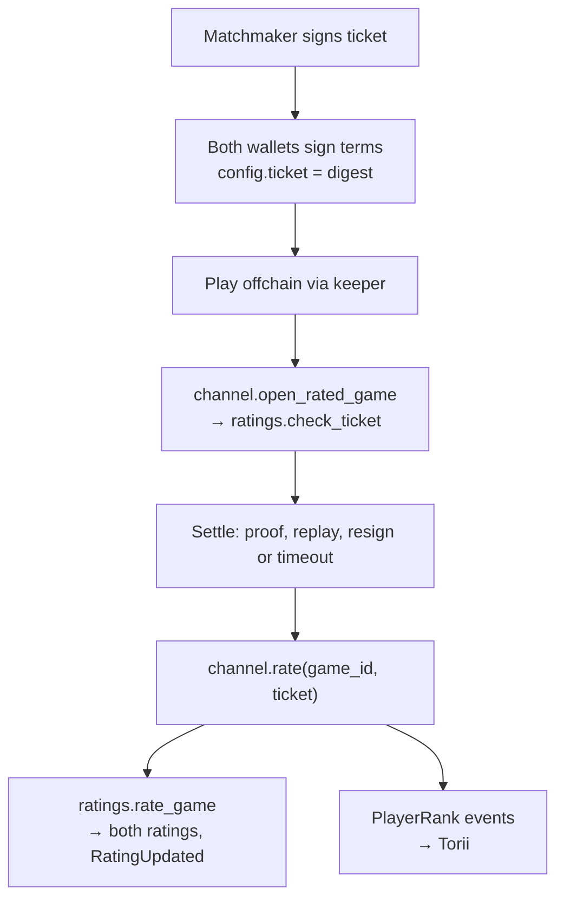

# How a game is rated

Every settled rated game updates both players' ratings in
**`SurroundRatings`**, a plain Starknet contract, and the rank the app shows
is derived from those ratings. Ratings carry status only (rank and peak
rank), because offchain play can't rule out engine assistance; games are
analyzed for it afterwards ([Fair play](/fair-play)).

## The pieces

- **The matchmaker** pairs players and signs a **ticket** for each pairing.
  It runs quick match (a queue paired by closest allowed rank on the same
  board and clock), open tables, and games against the
  [AI anchors](/ai-anchors). It also follows settled games and sends `rate`
  for them.
- **The channel** (the Dojo system that settles games) opens rated games on
  their tickets and reports settled ones.
- **`SurroundRatings`** checks tickets, holds every player's rating and runs
  the [rating update](/ranking/model). It is arbiter's `RatingsComponent` with
  Go's rules, and it never reads Dojo models: it takes the channel's word for
  results, and only from channels its owner allowlisted.

## Tickets

A ticket names, among other things:

- the chain and the channel;
- black and white;
- the rating pool (`'go'`: every board size shares one rating);
- hashes of the game's config (board and komi) and clock settings, plus the
  referee's key;
- the prover and the response window;
- the source (queue or table) and each player's starting band;
- the matchmaker key, `issued_at`, `expires_at` and a nonce.

The matchmaker signs the ticket's digest with its matchmaker key, kept apart
from any referee or account key. The game's terms carry that digest, and
both wallets sign the terms.

## Opening a rated game

When the game first needs the chain, the transaction opens it with
`open_rated_game(terms, signatures, ticket, signature)`. The channel asks
`SurroundRatings` to `check_ticket`, which enforces:

- the caller is the ticket's own channel, active, for the game whose terms
  carry the ticket's digest; white is neither zero nor black;
- the chain id matches;
- a starting band the policy allows, and only for a player with no rated
  games;
- an allowed referee, clock preset, komi for the board, prover and response
  window;
- the ticket lived at most 15 minutes (`issued_at` to `expires_at`), and
  hasn't been used before.

A ticket may be accepted after it expired: the game only opens when it first
needs the chain, which may be long after it was played.

:::tip[Why a player can't register only their wins]
Whether a game is rated is fixed by its signed terms. A game whose config
carries a ticket's digest can open only through `open_rated_game`, and a game
without one never counts. Both wallets signed the terms before the first
move.
:::

## Rating after settlement

Rating is a separate call after the game settles. Anyone may call
`rate(game_id, ticket)` on the channel: usually the keeper's after-settle hook,
or the matchmaker. A game settled with both players' approval can be rated
in the same transaction; one settled by a dispute is rated after
`resolve_dispute`.

The channel passes the settled game's facts (the result, its times and its
step count) to `rate_game`. The players, board, bands and keys come from the
ticket. `rate_game` runs once per ticket, updates both players and returns
their new states.

**`rate` never reverts on a game that isn't rateable**, so rating can never
block a settlement.

### When a game counts

A game is **void**, and changes no rating, if:

- it never started, or its start (the referee's first stamp) falls outside
  its ticket's window, give or take 60 s of clock skew;
- it's shorter than 20 steps, unless it ended onchain by resignation or
  timeout (then only the loser's rating changes, because a stale anchor may
  hide the game's real length);
- it started after its matchmaker key or referee key was revoked, or it was a
  timeout settled after the referee key's revocation;
- its data is invalid.

The game's start, not its settlement, is the time used for aging, so delaying
settlement can't change an update. An onchain forfeit that settles before
anything stamped reached the chain is dated by its ticket's `issued_at`, so a
losing player can't void a loss by opening the game and resigning first.

## Events

- **The audit trail.** `SurroundRatings` emits `TicketUsed`, carrying the
  whole ticket, and `RatingUpdated`, carrying each side's state before and
  after. `replay.mjs` in the SDK rechecks every rating and the chain of them
  from these events alone.
- **The mirror.** The channel emits a `PlayerRank` event per player, keyed by
  player, which Torii indexes so the app can query ranks without storage
  writes. It carries the game that set it, so a historical Torii keeps rank
  history too. `sync(player)` re-emits a player's rating to seed a new world's
  index.

