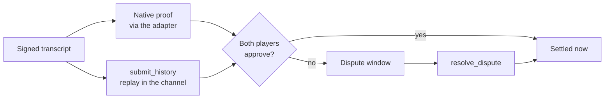

# Settling a game

A game that was played offchain settles in the first transaction that needs
the chain. That transaction opens the game on its signed terms and settles it,
so a game that never needed the chain costs nothing at all.

## Opening on first need

Nobody creates a game onchain before playing it. When the chain first needs
the game (usually for its settlement, sometimes for a dispute), the
transaction starts with one of:

- **`open_game(terms, signatures, referee_signature)`** for a casual or
  ranked game;
- **`open_rated_game(terms, signatures, ticket, signature)`** for a game the
  matchmaker paired, which also has `SurroundRatings` check the ticket (see
  [How a game is rated](/ranking/rated-games)).

Opening checks both wallets' signatures over the terms through their accounts
and writes the terms once. Anyone may send it; the keeper usually does. The
channel opens a game only under its own id, the hash of its seats, so no one
can claim the id first with other terms.

## Two ways to settle

The channel keeps one **anchor** per game: the hash of the last state both
players are committed to, starting from the opening state the terms fix.
Settling moves the anchor forward to a finished state. There are two ways to
show the channel the steps that get there.

### Native proof

The steps are replayed in a Cairo program and proved with Stwo through
Starknet's native proof verification
([SNIP-36](https://community.starknet.io/t/snip-36-in-protocol-proof-verification/116123)).
The transaction carries the proof's facts, and the network itself checks them
before the transaction executes.

The proof is consumed by the **proof adapter**, an immutable Cairo 2.18
contract with no administrator, no upgrade function and no arbitrary-call
entrypoint. It reads the channel's current anchor, checks the proved replay
started from it, and forwards the exact transition to the channel. The proof's
output binds the chain, the adapter's class and address, the game terms, the
channel's epoch, the input state and the output state.

The channel accepts that callback only from the game's prover, whose class
the namespace owner has allowlisted (`allow_prover`). Proof-shaped calldata
without native proof facts authorizes nothing.

- **One proof per game.** A proof costs about the same whatever its length,
  so a whole game is proved at once: a 311-step 19×19 game took one proof.
  Splitting a game into checkpoints only multiplies the fee.
- **A fresh base.** The network wants a proof based at least ten blocks
  behind the head; the adapter wants one no older than 4,000 blocks and no
  earlier than the current anchor. A stale proof is regenerated, never reused
  across an epoch change.
- **Who proves.** The prover sees the public transcript and signatures, never
  a session key, and doesn't decide the result: replay does. StarkWare's
  hosted transaction prover is the default, and arbiter ships a self-hostable
  one.

### Onchain replay

`submit_history` executes the same replay directly in the channel: the anchor
state, its position history and a **batch** of steps go in as calldata. A
batch carries the steps, each player's final signature
([why one is enough](/settlement/offchain-play#final-signature-authentication)),
and in a ranked game each step's clock stamp and the referee's last
attestation.

Replay is cheaper than a proof for a short game, and bounded by transaction
resources for a long one. Both paths accept exactly the same inputs and
produce the same state.

## When the result is final

Either path produces a candidate state. What happens next depends on whether
both players signed it:

- **Both players approve it.** A valid proof or replay plus both players'
  signatures over the resulting checkpoint commits it at once. A finished
  checkpoint settles the game in the same transaction, and a rated game can be
  rated in that transaction too.
- **Only one side submits it.** The submission opens a dispute: the candidate
  waits out the game's response window, during which the opponent may answer
  with a better-supported history, and then `resolve_dispute` makes it the
  anchor. This is how a game settles when the loser won't sign, for example
  after losing on time. See [Disputes](/settlement/disputes).
- **A player resigns onchain.** `resign_channel` concedes from the wallet,
  without a proof or the opponent's signature.

Every committed checkpoint increments the game's **epoch**, so older proofs
and checkpoint approvals can't be replayed. Move signatures stay valid across
checkpoints because they bind the terms and the transcript, not the epoch. An
unfinished checkpoint lets a long game be committed in segments without
ending it.

When a game settles, the channel records the block timestamp of the
settling transaction (`Settlement`). Kifu are dated by it.

## Trust assumptions

A proof replaces trust in the players, not every assumption:

- **SNIP-36, phase one.** Native proofs are verified in Starknet consensus.
  That verification is not yet itself proved through SNOS to Ethereum.
- **Dojo world ownership.** The world's owner keeps upgrade and
  administrative powers unless they are frozen or governed explicitly, and
  allowlists the adapter classes.
- **No audit.** The contracts have not had an independent audit.
- **Not anti-cheat.** A proof shows the moves were legal and signed. It
  doesn't show who chose them: it can't prevent engine assistance, collusion,
  deliberate losses or Sybil accounts. Engine assistance is caught by
  analysis instead ([Fair play](/fair-play)).
